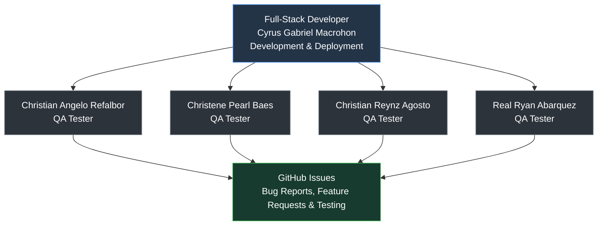

# Parkiva [Visit Us!](https://prkiva.vercel.app)

**Smart Parking. Simple Reservations.**

Parkiva is a web-based Public Parking Reservation and Management System designed to make parking more convenient for drivers and easier to manage for participating parking facilities.

The platform is intended to help users locate participating parking areas, check availability, reserve a space before arriving, manage vehicle information, and use QR-based verification during entry and exit. For parking operators, it is intended to provide a centralized way to monitor reservations, vehicles, and parking slot statuses: Available, Reserved, and Occupied.

## Development Workflow

Parkiva follows a developer-led workflow supported by a dedicated Quality Assurance (QA) team.

### Project Management

Development tasks, feature requests, and QA reports are
tracked using GitHub Issues and GitHub Projects.

[View Parkiva Development Board](https://github.com/orgs/UIC-CCS-WEB-DEVELOPMENT-2026-2027/projects/12)

## Project Objectives

- Reduce the time drivers spend searching for parking.
- Let users check availability before arriving at a destination.
- Provide a simple parking reservation process.
- Maintain clear reservation and vehicle records.
- Support QR-based verification for parking entry and exit.
- Help operators monitor occupancy and reservations.
- Provide an organized parking experience for drivers and operators.

## Core Features

Parkiva's intended core functionality includes:

- Parking facility discovery and slot availability
- Parking reservations with date and time selection
- Vehicle information management
- Unique QR codes for confirmed reservations
- QR-based entry/check-in and exit/check-out verification
- Parking status management: Available, Reserved, and Occupied
- Reservation history
- Parking operator management tools

## How Parkiva Works

The intended reservation workflow is:

1. A user finds a participating parking facility.
2. The user checks available spaces.
3. The user selects a parking slot and reservation period.
4. Parkiva creates the reservation and provides a unique QR code.
5. At entry, authorized parking staff scan the code to verify the reservation and mark the slot as Occupied.
6. At exit, staff scan the code again to record departure and return the slot to Available.
7. The completed session is recorded in the user's reservation history.

## Development Team

Parkiva is developed by:

- Cyrus Gabriel Macrohon
- Christian Angelo Refalbor
- Christene Pearl Baes
- Christian Reynz Agosto
- Real Ryan Abarquez

## Academic Project

Parkiva is developed as an academic web development project under the College of Computer Studies of the University of the Immaculate Conception.

## Branding

Parkiva uses its own visual identity and `parkiva.png` as the official project logo. The favicon uses the logo symbol without the wordmark.
